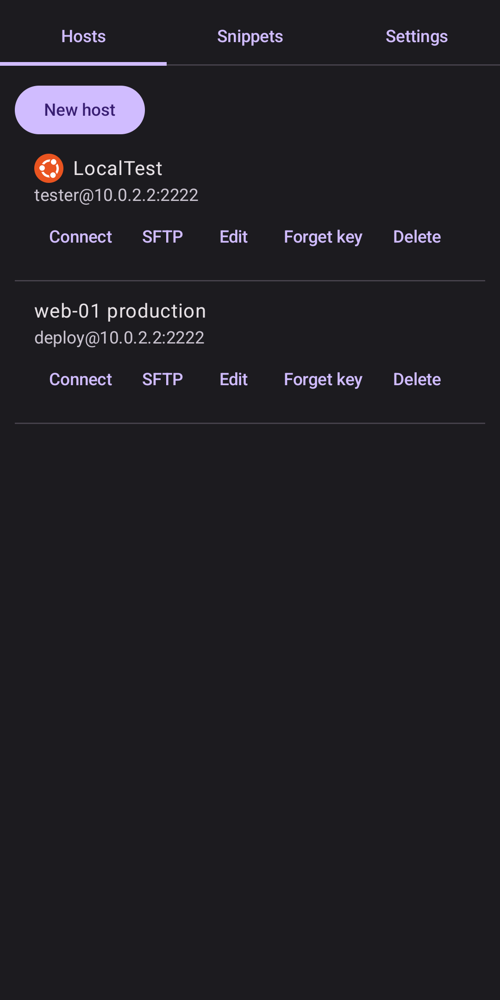
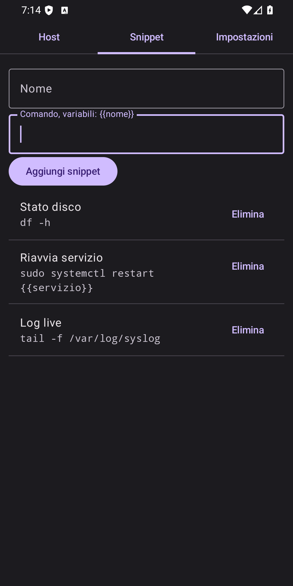
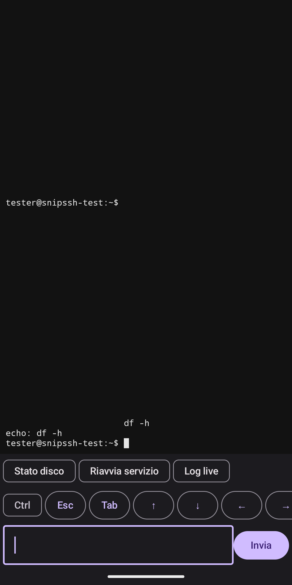
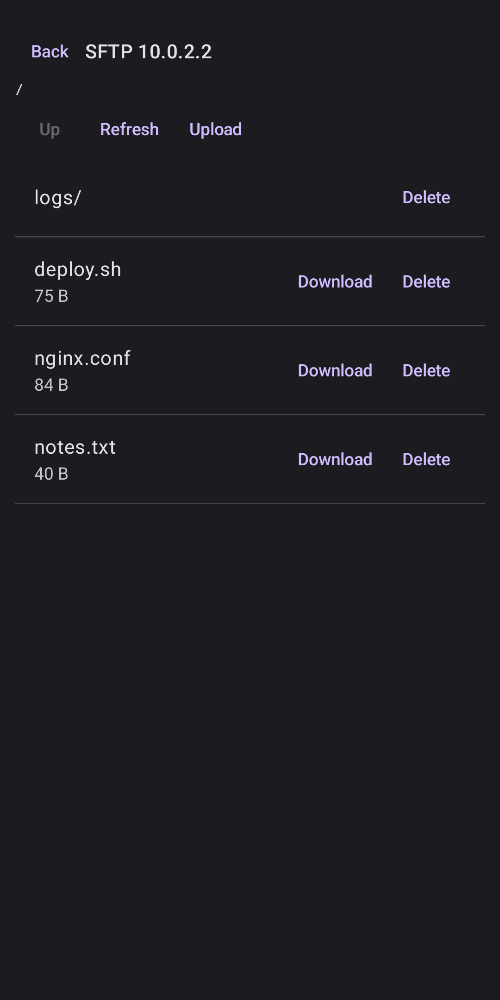
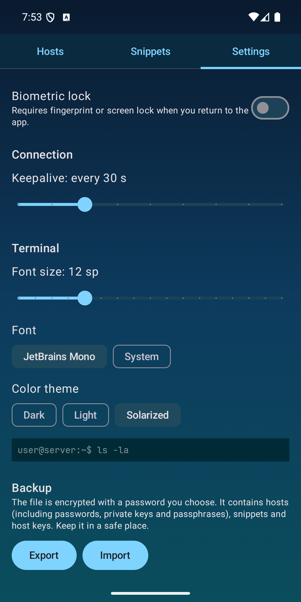
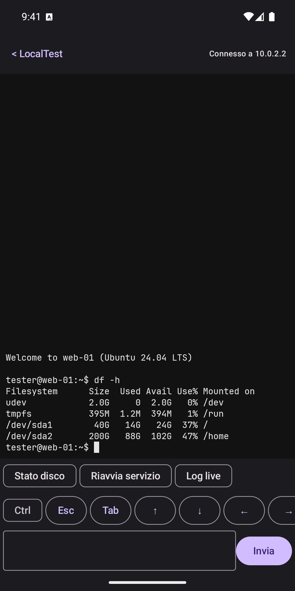
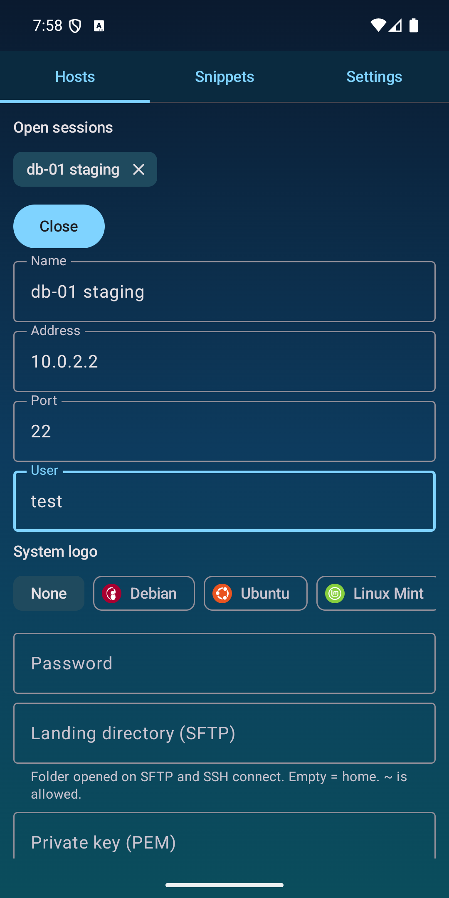
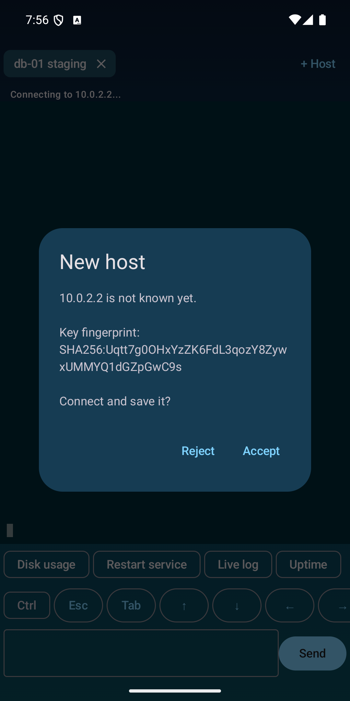
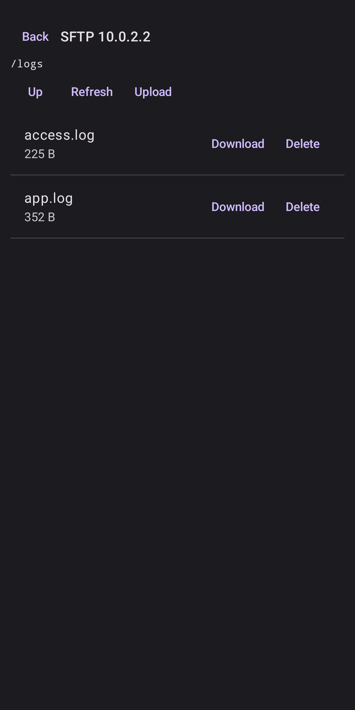

# SnipSSH

**SnipSSH: terminale SSH e file manager SFTP in un'unica app, per Android e Windows, con snippet di comandi.** Senza abbonamento e senza account.

Client SSH e SFTP per Android e Windows con gestione di snippet di comandi riutilizzabili. Nessun account, nessuna pubblicità, nessun server intermedio: la connessione va dal dispositivo direttamente al tuo server. La [versione per Windows](#versione-windows) ha le stesse funzioni di quella Android.

## Download

Il modo più semplice è installarla dallo store, con aggiornamenti automatici:

- **Android**: [Google Play](https://play.google.com/store/apps/details?id=io.github.joescaramucci.snipssh)
- **Windows 10/11**: [Microsoft Store](https://apps.microsoft.com/detail/9N8SQQV503LP). Il pacchetto è firmato da Microsoft, quindi niente avvisi di SmartScreen.

In alternativa, i file si scaricano da GitHub.

Ultima versione: **0.3.5**, nella [pagina delle release](https://github.com/joescaramucci/snipssh/releases/tag/v0.3.5).

| File | Per |
|---|---|
| `SnipSSH-0.3.5-android.apk` | Android 8.0 o successivo (installazione da file, consentire l'origine sconosciuta) |
| `SnipSSH-0.3.5-windows-setup.exe` | Windows 10/11 64 bit, installazione per utente |
| `SnipSSH-0.3.5-windows.msi` | Windows 10/11 64 bit, pacchetto MSI per utente |
| `SnipSSH-0.3.5-windows-portable.zip` | Windows 10/11 64 bit, nessuna installazione: estrai e avvia `SnipSSH.exe` |

Ogni file ha il proprio SHA-256 in `SHA256SUMS.txt`. Gli eseguibili Windows non sono firmati, quindi SmartScreen può mostrare un avviso alla prima esecuzione.

## Screenshot

<table>
  <tr>
    <td></td>
    <td></td>
    <td></td>
  </tr>
  <tr>
    <td></td>
    <td></td>
    <td></td>
  </tr>
  <tr>
    <td></td>
    <td></td>
    <td></td>
  </tr>
</table>

## Funzionalità

- **Terminale SSH** con emulazione ANSI (colori, cursore, scroll) e tasti speciali (Esc, Tab, Ctrl, frecce).
- **Lingue**: inglese (predefinito), italiano, spagnolo, francese, tedesco, cinese semplificato, russo e coreano. Si scelgono in Impostazioni e l'app si aggiorna subito.
- **Aspetto del terminale** in Impostazioni: dimensione del carattere (8–24 sp), font di sistema o JetBrains Mono, tema colori Scuro, Chiaro o Solarized. Con due dita sul terminale si ingrandisce o riduce il testo, e la dimensione viene salvata.
- **Sessioni multiple**: puoi tenere aperte più connessioni contemporaneamente. Ogni sessione è un chip in alto nel terminale: tocca il nome per passare da una all'altra senza disconnettere le altre. `+ Host` apre un'altra connessione, la × chiude la sessione.
- **Uscita dalla sessione**: digitando `exit` si chiude solo la sessione corrente. Le altre restano aperte, e chiudendo l'ultima si torna alla lista host.
- **Orizzontale**: con il telefono in orizzontale la colonna destra mostra host, snippet e tasti rapidi, scorrevole; il terminale occupa la parte sinistra, con la riga di input compatta.
- **Logo della distribuzione** accanto al nome dell'host (Debian, Ubuntu, Linux Mint, Fedora, Red Hat, Arch, Alpine, Windows, macOS, FreeBSD o generico), scelto nel form dell'host.
- **Cronologia dei comandi** per host: mentre digiti (es. `cd`) compaiono i comandi già usati che iniziano così, dal più usato al meno usato.
- **Snippet** con nome e variabili tipo `{{servizio}}`, lanciabili sul server con un tocco e conferma.
- **Host** con autenticazione a password oppure chiave privata, con passphrase opzionale.
- **Chiavi**: accetta chiavi private in formato OpenSSH o PEM, di tipo RSA, ECDSA ed Ed25519. Le chiavi PuTTY `.ppk` non sono supportate: convertile con PuTTYgen, aprendo il file con *File → Load private key* e poi scegliendo *Conversions → Export OpenSSH key*. Non usare *Save private key*, che salva di nuovo in formato `.ppk`.
- **Verifica delle chiavi host** alla prima connessione, con avviso se la chiave del server cambia.
- **Temi dell'app**: 8 palette (Aurora, Ocean, Sunset, Forest, Midnight, Graphite, Cocoa, Moss), scelte in Impostazioni.
- **SFTP**: elenco in stile `ls -l` (nome, permessi, dimensione, data), con percorso modificabile e una cartella di partenza per ogni host (con `cd` automatico dopo la connessione). I nomi lunghi vanno a capo invece di essere troncati, e i permessi si modificano. Si può sfogliare, scaricare, caricare ed eliminare file e cartelle vuote.
- **Sicurezza**: blocco biometrico opzionale; dati locali cifrati con `EncryptedSharedPreferences`.
- **Backup** esportabile in un file cifrato con una password scelta dall'utente.
- **Colore per host**: ogni host può avere un colore che evidenzia la sua riga nell'elenco. Su Android si apre con un tocco lungo sulla riga, su Windows con il tasto destro. Il colore si salva nel backup.
- **Crediti** in alto in ogni schermata.

## Versione Windows

App per Windows 10/11 (64 bit) con le stesse funzioni di quella Android: host, shell SSH, SFTP, snippet, temi, 8 lingue e backup cifrato. È scritta in Compose Desktop e condivide il codice con l'app Android: la logica SSH/SFTP, l'emulatore ANSI e i modelli stanno nel modulo `core`.

- **Schede**: shell e SFTP si aprono in schede. `+ Host` torna alla lista, la × chiude la scheda.
- **Vista affiancata**: il pulsante *Affianca* nella barra in alto mostra fino a 4 schede una accanto all'altra, per vedere insieme una shell SSH e una connessione SFTP. Si aprono subito 2 pannelli; le altre schede restano nella barra e, quando le selezioni, prendono il posto del pannello con il fuoco. Trascina i divisori per cambiare la larghezza dei pannelli. Un click su un pannello gli dà il fuoco, e *Vista singola* torna a una scheda sola.
- **Terminale**: tastiera completa (frecce, F1–F12, Ctrl+lettera, AltGr), selezione col mouse e rotella per scorrere. Copia con `Ctrl+Maiusc+C` (o `Ctrl+C` se c'è una selezione, o `Ctrl+Ins`), incolla con `Ctrl+Maiusc+V` o `Maiusc+Ins`. `Maiusc+PagSu/PagGiù` scorre lo storico. `Ctrl+rotella`, `Ctrl++`, `Ctrl+-` e `Ctrl+0` cambiano la dimensione del testo. Gli snippet sono nella colonna a destra.
- **SFTP**: doppio click per entrare in una cartella, caricamento di più file insieme, download con la finestra "Salva con nome".
- **Dati**: in `%APPDATA%\SnipSSH`, cifrati con AES-256-GCM. La chiave è protetta da DPAPI di Windows, quindi solo lo stesso utente Windows sullo stesso PC può leggerli. Il blocco biometrico resta solo su Android. I file di backup `.ssb` sono interscambiabili con l'app Android.

### Build per Windows

```powershell
.\gradlew.bat :desktop:run                              # avvia l'app
.\gradlew.bat :desktop:createDistributable              # cartella portabile con SnipSSH.exe
.\gradlew.bat :desktop:packageMsi :desktop:packageExe   # installer MSI e setup EXE
.\gradlew.bat :desktop:packageMsix                      # pacchetto MSIX per il Microsoft Store
```

Per l'MSIX serve il Windows SDK 10 (`makeappx`, `makepri`): vedi [docs/microsoft-store.md](docs/microsoft-store.md).

Per gli installer servono JDK 17 (include `jpackage`) e [WiX Toolset 3.14](https://github.com/wixtoolset/wix3/releases/tag/wix3141rtm), con `candle.exe` e `light.exe` nel `PATH`; basta estrarre l'archivio dei binari, senza installarlo. I risultati sono in `desktop/build/compose/binaries/main/` (`app/`, `msi/`, `exe/`). L'installer lavora per utente in `%LOCALAPPDATA%\SnipSSH` e non richiede privilegi di amministratore. L'eseguibile non è firmato: alla prima esecuzione SmartScreen può mostrare un avviso.

Traduzioni, icone dei loghi e font vengono copiate dalle risorse Android a ogni build, e l'icona è `docs/store/icon-512.png`: non vanno duplicate nel modulo desktop.

## Requisiti

- Android 8.0 (API 26) o successivo.
- Windows 10 o 11 a 64 bit per la versione desktop.
- Per compilare: JDK 17 e Android SDK con platform 36.

## Specifiche tecniche

| Voce | Valore |
|---|---|
| Versione | 0.3.5 (`versionCode` 8) |
| Android | minSdk 26 (Android 8.0), targetSdk 36, compileSdk 36 |
| Windows | Windows 10/11 a 64 bit, Compose Desktop 1.6.11, JDK 17; exe portabile, MSI e setup EXE (non firmati, per utente) |
| Moduli Gradle | `:core` (Kotlin/JVM, logica condivisa), `:app` (Android), `:desktop` (Windows) |
| Linguaggio e build | Kotlin 1.9.24, Gradle 8.7, Android Gradle Plugin 8.5.2, JVM target 17 |
| Interfaccia | Jetpack Compose (BOM 2024.06.00) e Compose Desktop, Material 3 |
| Client SSH/SFTP | JSch 2.28.8 (`com.github.mwiede:jsch`), condiviso tra Android e Windows |
| Chiavi host | RSA, ECDSA e ed25519 (ed25519 tramite BouncyCastle `bcprov-jdk18on` 1.86) |
| Archiviazione | Android: `EncryptedSharedPreferences`; Windows: file in `%APPDATA%\SnipSSH` cifrato AES-256-GCM, chiave protetta con DPAPI |
| Blocco biometrico | solo Android |
| Backup | file cifrato protetto da password scelta dall'utente |
| Temi | 8 temi app, 3 temi terminale (Scuro, Chiaro, Solarized) |
| Font terminale | JetBrains Mono (licenza OFL) o font di sistema |
| Lingue | 8 (inglese, italiano, spagnolo, francese, tedesco, cinese semplificato, russo, coreano) |

## Build

```powershell
.\gradlew.bat :app:assembleDebug        # Windows
./gradlew :app:assembleDebug            # Linux / macOS
```

Per installare sul dispositivo o sull'emulatore collegato:

```powershell
.\gradlew.bat :app:installDebug
```

### Release firmata

La firma è configurata in `app/build.gradle.kts` e legge queste proprietà da `gradle.properties` globale (`~/.gradle/gradle.properties`) oppure da una riga di comando, mai dal repository:

```properties
SSHSNIPPETS_UPLOAD_STORE_FILE=C:/percorso/sshsnippets-upload.jks
SSHSNIPPETS_UPLOAD_STORE_PASSWORD=...
SSHSNIPPETS_UPLOAD_KEY_ALIAS=upload
SSHSNIPPETS_UPLOAD_KEY_PASSWORD=...
```

Poi:

```powershell
.\gradlew.bat :app:bundleRelease        # app/build/outputs/bundle/release/app-release.aab
```

Le chiavi di firma (`*.jks`, `*.keystore`) e le password non devono mai finire nel repository: il `.gitignore` le esclude.

## Limiti noti

- Il terminale non supporta applicazioni a schermo intero come `vim` o `htop`.
- Le variabili degli snippet accettano lettere di qualsiasi alfabeto, cifre e `_` (`{{servizio}}`, `{{città}}` o `{{имя}}` sì; spazi e simboli no).
- Le chiavi sono associate al singolo host, non condivise.
- Nessuna sincronizzazione cloud: il backup è un file che gestisci tu.
- SFTP non cancella le cartelle non vuote.
- Importare un backup sostituisce i dati presenti nell'app.
- Nella vista affiancata la colonna snippet di ogni pannello è fissa e stretta (160 dp) e il suo divisore è nascosto, per lasciare spazio al terminale. La larghezza scelta in vista singola non cambia.

## Sostieni il progetto

SnipSSH è gratuito e senza pubblicità. Se ti è utile, puoi fare una donazione su PayPal a joe.scaramucci@gmail.com oppure con il pulsante *Sponsor* in alto nella pagina del repository.

## Documentazione

- [docs/play-store.md](docs/play-store.md): scheda Google Play, privacy policy, modulo Data Safety, checklist di pubblicazione.
- [Privacy policy](https://joescaramucci.github.io/snipssh/privacy.html) (EN e IT).
- [docs/store/](docs/store/): icona, feature graphic e screenshot per lo store.

## Struttura

```
core/src/main/kotlin/com/example/sshsnippets/     logica condivisa Android + Windows (JVM puro)
  SshSession.kt        connessione SSH, verifica chiave host
  SftpClient.kt        client SFTP e helper di percorso
  AnsiTerminal.kt      emulatore ANSI
  HostKeys.kt          chiavi host note (TOFU)
  Models.kt            host, snippet, cronologia
  Backup.kt            export / import cifrato

app/src/main/java/com/example/sshsnippets/        app Android
  MainActivity.kt      schede Host / Snippet / Impostazioni
  Locales.kt           lingue disponibili e lingua predefinita
  TerminalScreen.kt    terminale e tasti rapidi
  Sftp.kt              schermata SFTP
  Store.kt             archiviazione cifrata (EncryptedSharedPreferences)
  AppLock.kt           blocco biometrico
  OpenSessions.kt, SessionBar.kt, HostKeyDialog.kt, ChmodDialog.kt,
  AppThemes.kt, TerminalThemes.kt, Distros.kt   file Compose condivisi con il desktop

desktop/src/main/kotlin/com/example/sshsnippets/  app Windows (Compose Desktop)
  DesktopMain.kt, App.kt        finestra e schede
  HostsScreen.kt, SettingsScreen.kt, TerminalScreen.kt, SftpScreen.kt
  Store.kt             archiviazione cifrata con DPAPI
  Platform.kt          traduzioni (le stesse di Android) e servizi di piattaforma

app/src/main/res/values*/strings.xml   testi (inglese predefinito, poi it, es, fr, de, zh-rCN, ru, ko)
```

## Licenza

[MIT](LICENSE)

Il font JetBrains Mono (`app/src/main/res/font/`) è distribuito con licenza SIL Open Font License 1.1, il cui testo è in [docs/fonts/JetBrainsMono-OFL.txt](docs/fonts/JetBrainsMono-OFL.txt).

I loghi delle distribuzioni (`app/src/main/res/drawable/ic_distro_*.xml`) provengono da [Simple Icons](https://simpleicons.org) (licenza CC0 1.0). I marchi (Debian, Ubuntu, Linux Mint, Fedora, Red Hat, Arch Linux, Alpine Linux, Apple/macOS, FreeBSD, Tux/Linux) restano di proprietà dei rispettivi titolari e sono usati solo per identificare il sistema operativo. Il logo Microsoft Windows non è disponibile in Simple Icons, quindi viene usata un'icona generica di monitor creata per questo progetto.